<div align="center">

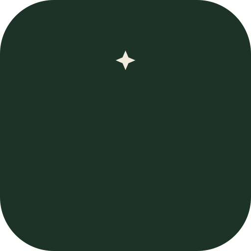

# Cartharise

**Understand yourself. Choose your path. Rise with purpose.**

A calm, private companion to Dan Koe's article *How to fix your entire life in 1 day*:
learn the ideas, take the one‑day reset, and turn your own answers into a direction and small daily steps.

<p>
  
  
  
  
  
  
  
  
</p>

<p>
  &nbsp;&nbsp;
  &nbsp;&nbsp;
  &nbsp;&nbsp;
  &nbsp;&nbsp;
  &nbsp;&nbsp;
  &nbsp;&nbsp;
  &nbsp;&nbsp;
  
</p>

</div>

---

## Contents

- [Why Cartharise](#why-cartharise)
- [Screenshots](#screenshots)
- [Features](#features)
- [How it works](#how-it-works)
- [Gentle by design](#gentle-by-design)
- [Tech stack](#tech-stack)
- [Getting started](#getting-started)
- [Project structure](#project-structure)
- [Privacy](#privacy)
- [Testing](#testing)
- [Status & roadmap](#status--roadmap)
- [Credits & licences](#credits--licences)

---

## Why Cartharise

The article describes a single, demanding day: honest questions in the morning, interruptions to
autopilot during the day, and an evening that turns what you found into a direction. It is easy to
read and hard to actually do. The questions are scattered, the timing matters, and your answers end
up in a notes app you never open again.

Cartharise turns the article into something you can **do**. It asks one question at a time and saves
every word as you type. It nudges you at the check‑in times and helps you build a direction from
your own answers, never from guesses. Nothing locks, nothing expires, and nothing leaves your phone.

> **Learn the ideas → Take the reset → Choose a direction → Take small steps → Look back.**

Cartharise is independent and not affiliated with Dan Koe. Its lessons and questions are paraphrased
and credited, and the article itself is never reproduced (see [Credits](#credits--licences)).

---

## Screenshots

<table>
  <tr>
    <td align="center">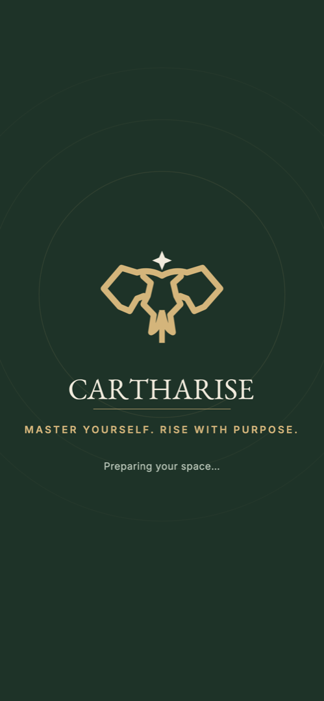<br><sub>Loading</sub></td>
    <td align="center">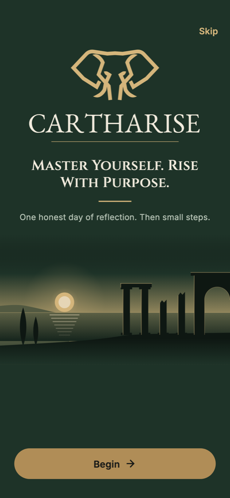<br><sub>Welcome</sub></td>
    <td align="center">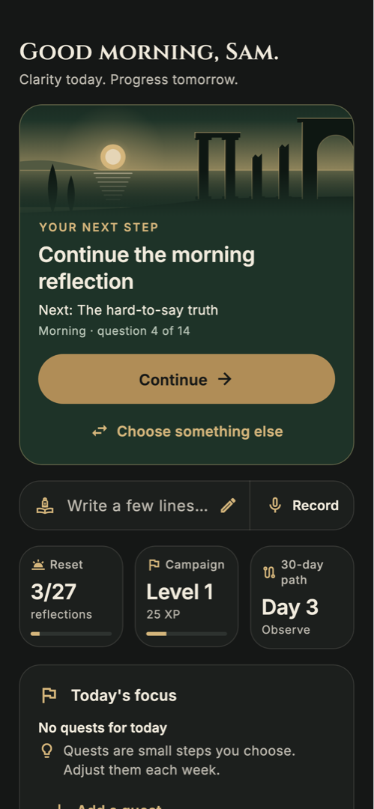<br><sub>Today</sub></td>
  </tr>
  <tr>
    <td align="center">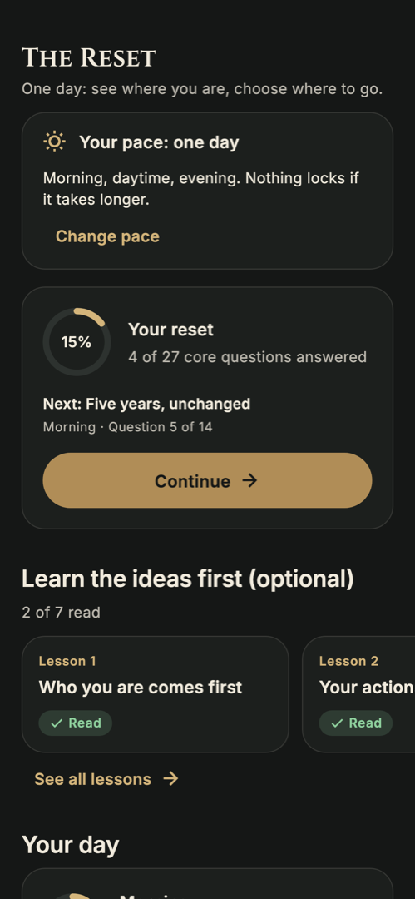<br><sub>The Reset</sub></td>
    <td align="center">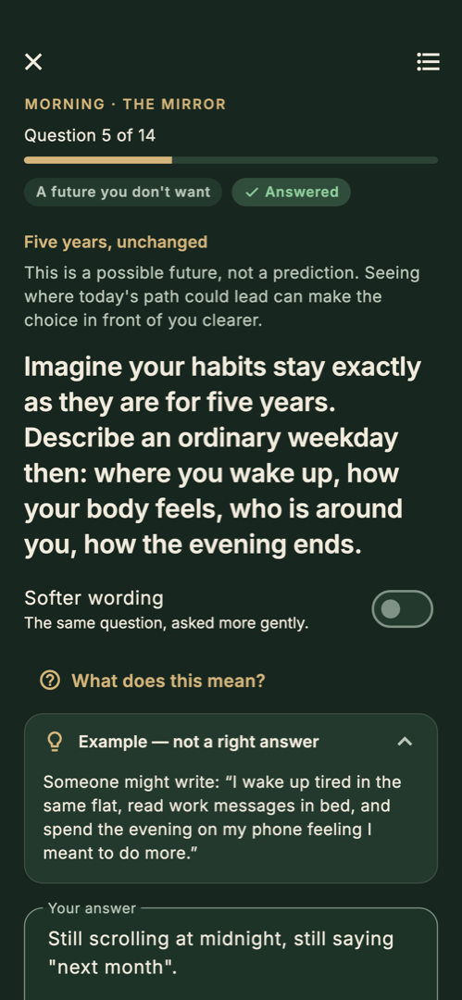<br><sub>One question at a time</sub></td>
    <td align="center">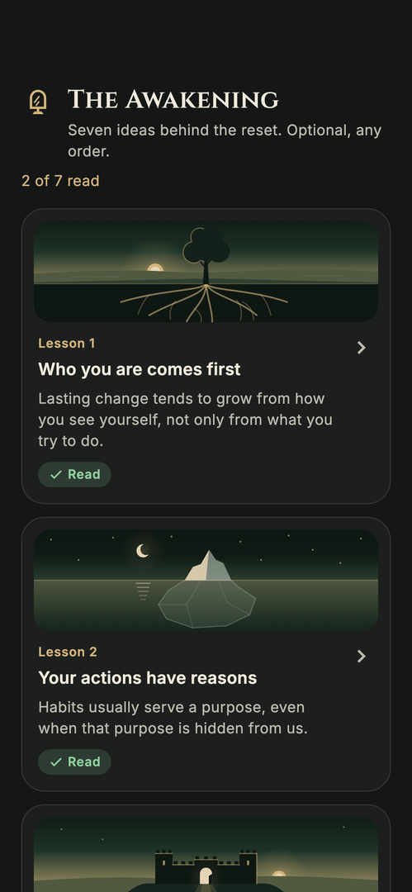<br><sub>The Awakening (lessons)</sub></td>
  </tr>
  <tr>
    <td align="center">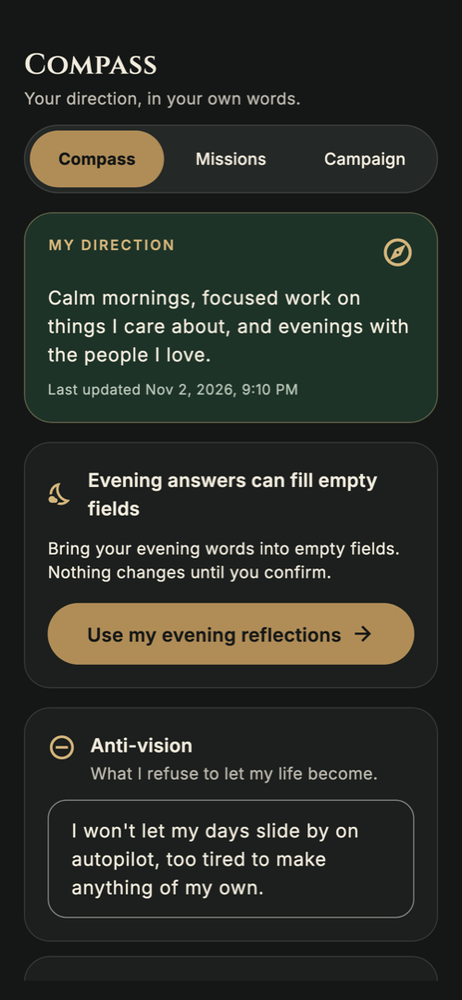<br><sub>Life Compass</sub></td>
    <td align="center">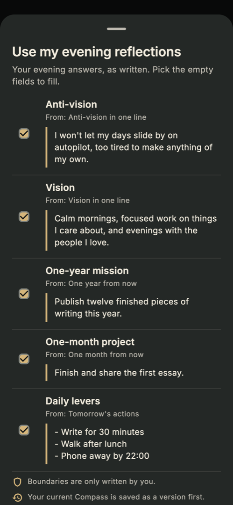<br><sub>Previewed import</sub></td>
    <td align="center">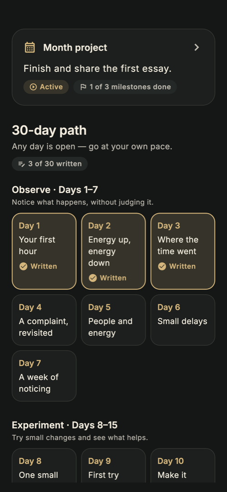<br><sub>Month project & 30‑day path</sub></td>
  </tr>
  <tr>
    <td align="center">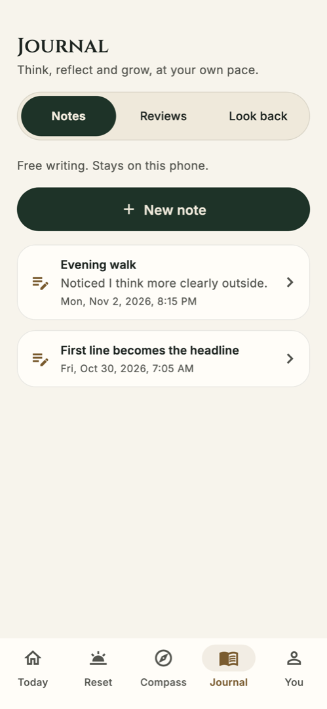<br><sub>Journal · light</sub></td>
    <td align="center">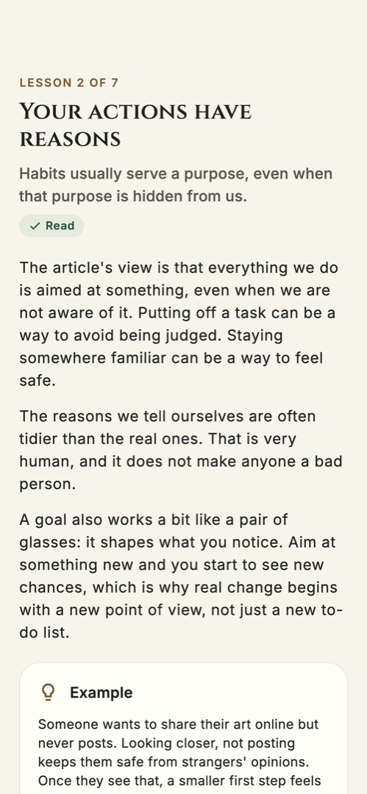<br><sub>Lesson · light</sub></td>
    <td align="center">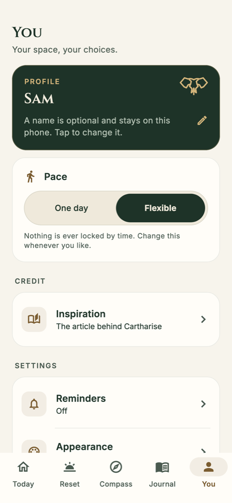<br><sub>You · light</sub></td>
  </tr>
  <tr>
    <td align="center">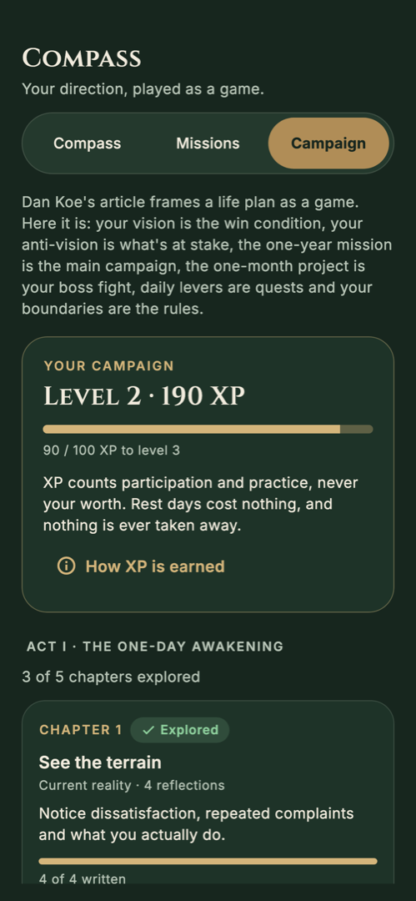<br><sub>The Campaign</sub></td>
    <td align="center">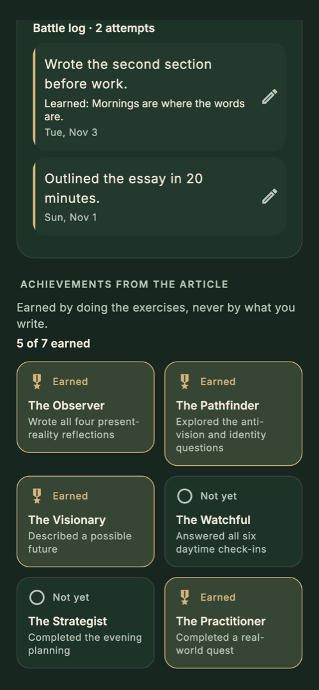<br><sub>Battle log & achievements</sub></td>
    <td align="center">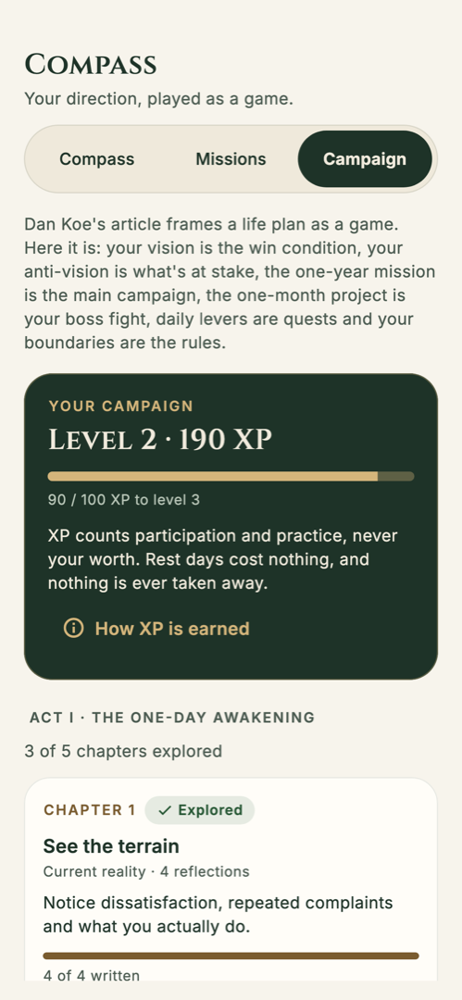<br><sub>The Campaign · light</sub></td>
  </tr>
</table>

<sub>Rendered from the real widgets with <code>make screenshots</code>, then cropped to one phone screen. See <a href="#testing">Testing</a>.</sub>

---

## Features

Five tabs: **Today · Reset · Compass · Journal · You**.

**Today: where you left off**
- 🧭 **Your next step**, worked out from what you've actually done: start, resume, build your Compass, turn levers into quests, or reflect on your week
- ✅ Today's quests, a gentle progress ring ("3 of 27 reflections written"), and your vision and month project at a glance

**Reset: the one‑day reset, one question at a time**
- 🌅 **Morning:** 14 questions (*The Mirror*: current reality, possible futures, identity; *The Vision*: a good ordinary day and who you want to become)
- ⏰ **Daytime:** 6 timed check‑ins (*The Interrupt*) at the source times 11:00 · 13:30 · 15:15 · 17:00 · 19:30 · 21:00, plus 3 optional contemplations
- 🌙 **Evening:** 7 questions (*The Breakthrough*) that become your Compass
- ✍️ Saved on the device as you type. Every question has "What does this mean?" and an example that is *not* a right answer, and most offer softer wording. You can go back, skip, jump or pause at any time
- 📜 Past resets stay readable, exactly as you wrote them

**Awakening: the ideas behind it**
- 📖 Seven short lessons in plain words, each with an example, *a lens, not a verdict*, a knowledge check that is never scored or saved, and "Try it" links into the matching questions
- Optional, in any order. You can start the reset without reading anything

**Compass: your direction, in your own words**
- 🧭 Six fields: **anti‑vision, vision, one‑year mission, one‑month project, daily levers, boundaries**
- 📥 **Use my evening reflections:** a preview with a checkbox per field that only fills *empty* fields, and only once you confirm. Boundaries are only ever written by you
- 🕰️ Versions: save one, compare it with now, restore it. A version is kept automatically before every import or restore

**Missions: small steps**
- ⚡ Daily levers become up to three **editable** daily quests, never added without your OK
- ✅ One‑off and daily quests with Undo. A month project with milestones
- 🗺️ An optional **30‑day path** in four stages (Observe · Experiment · Build · Adjust). Every day is open, go at your own pace

**Campaign: the article as a game (optional)**
- ♜ Section VII of the article made playable: your vision is the **win condition**, the anti-vision is **what's at stake**, the one-year mission is the **main campaign**, the one-month project is your **boss fight**, daily levers are **quests** and your boundaries are the **rules of engagement**
- 📜 **Act I:** five chapters built from the reset's exercises (4 · 7 · 3 · 6 · 7 questions), each opening its first open question
- 🛡️ **Monthly boss fight:** record what you tried and what you learned in a battle log you can correct or delete
- 🏅 **XP, levels and seven achievements**, earned only by doing: answering a question, completing a quest, writing a 30-day note, recording an attempt, a weekly review. XP never looks at what you write, rest never costs anything, and one switch in You turns the whole layer off

**Journal: write and look back**
- 📝 Free notes, **weekly reviews** (wins, friction, next experiment)
- 🔍 **Look back:** compare two Compass moments side by side and reread earlier resets

**You: your space, your choices**
- 🙏 **Inspiration:** the article, its author and both links, and what is from the source vs added by Cartharise
- 🔔 **Reminders:** opt‑in, six editable check‑in times, quiet hours, or **Add to calendar (.ics)** if you'd rather not get notifications
- 🎨 **Appearance:** Forest or Olive theme · system / light / dark · motion on/off
- 💾 **Your data:** export or restore a JSON backup, or delete everything
- 💚 **Support & safety:** what to do when a question feels heavy, and where to find help

**Made for real life**
- Works fully **offline**, on 320 dp phones up to tablets, at up to 200 % text size
- Dark & light, reduced motion honoured, screen‑reader labels, 48 dp tap targets, keyboard navigation

---

## How it works

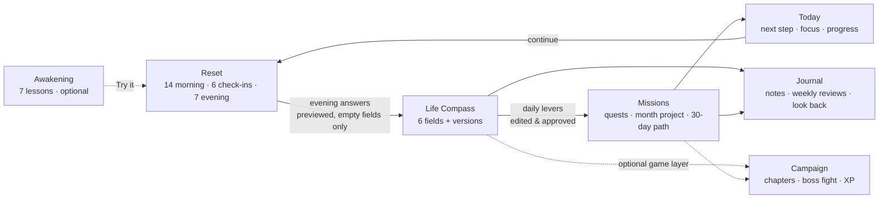

The app is a single Flutter codebase. One `AppState` (a `ChangeNotifier`) holds an immutable
`AppData` snapshot. Every change goes through `mutate`: the screen updates at once, then the
snapshot is written **atomically** to one JSON file (temp file + rename) through a serialised queue.
If a write fails, your words stay on screen and the app says so, offering **Retry** or
**Export a copy**. A damaged file is never overwritten.

The guided content (lessons, 30 questions, the 30‑day path, the credit) is plain Dart in
[`lib/content/`](lib/content), separate from UI strings, so the app can be translated. The
domain layer is pure Dart and unit‑tested. Details: [`docs/architecture.md`](docs/architecture.md).

---

## Gentle by design

> **Your words are yours. Your pace is yours.**

- **Every question can be skipped.** Most can be asked more gently, and *Feeling heavy?* always offers soften, skip, pause or support (with a link to a helpline directory)
- **No streaks, countdowns or guilt.** Progress is counted in words, and nothing locks by time. The optional Campaign's XP counts participation only: it never drops, never judges what you write, and turns off in one tap
- **Your words are saved exactly as typed.** Nothing is rewritten, summarised or inferred
- **No labels or diagnoses.** Lessons are lenses, not verdicts. Cartharise is not therapy, and says so
- **Honest when something fails.** Failed saves, denied notification permission and bad backups are shown plainly, with a practical alternative
- For adults (18+), confirmed during onboarding

---

## Tech stack

| | Layer | What's used |
|---|---|---|
|  | App & UI | **Flutter 3.47**, Material 3, `provider`, "Carthage Dusk" role‑token palette (`CarthaPalette`), Forest & Olive themes |
|  | Core logic | **Dart 3.13**: pure‑Dart domain, hand‑written JSON, `intl` + gen‑l10n from per‑area ARB fragments |
| 🎨 | Brand & motion | `EmblemGeometry` (one source for the emblem, its SVGs and icons), the "charging" loader as a `CustomPainter`, `flutter_svg` lockups, vector brand scenes |
| 🔔 | Reminders | `flutter_local_notifications` (inexact daily), `timezone` + `flutter_timezone`; pure `.ics` export |
| 💾 | Files | `path_provider` (atomic JSON store), `share_plus` (export), `file_picker` (restore) |
| 🔗 | Links | `url_launcher`, used only for the credited article links and the helpline directory |
|  | Typography | **Cinzel** for headlines, **Inter** for everything else (both bundled, OFL) |
|  | iOS native | **Swift**: excludes the data folder from iCloud/computer backups |
|  | Android native | **Kotlin** host; manifest rules keep data out of cloud backup and device transfer |
|  | Build | Gradle (Kotlin DSL), `flutter_launcher_icons`, `flutter_native_splash` |
|  | Testing | `flutter_test`: size matrix, accessibility guidelines, end‑to‑end journeys, rendered screenshots |

---

## Getting started

### Prerequisites

- Flutter **3.47+** (Dart 3.13)
- Android SDK + JDK 17–21 for Android
- A Mac with **Xcode** for iOS

### Run

```bash
make deps                   # flutter pub get
make run                    # on a connected phone or emulator
make                        # list every target
```

### Build

```bash
make android                # debug APK
make android-release        # release APKs, one per CPU type (obfuscated)
make ios                    # iOS compile check (needs Xcode)
```

### Strings, icons & splash

```bash
make l10n                   # merge l10n_src/*_en.arb → lib/l10n, then generate AppLocalizations
make brand                  # re-export emblem SVGs, lockups, icon + splash PNGs from EmblemGeometry
make icons                  # launcher icons from assets/brand/app_icon_1024.png
make splash                 # native splash screens (forest + emblem)
```

The emblem is drawn in code (`EmblemGeometry` in `lib/ui/widgets/emblem.dart`); every brand
asset is exported from it, and `make check` fails if one drifts.

Add UI strings to your area's fragment in `l10n_src/<area>_en.arb`, not to `lib/l10n/` (that folder
is generated).

---

## Project structure

```text
lib/
├── domain/          content model, AppData (+ JSON), local dates, backup format (pure Dart)
├── content/         ContentLibrary per language: lessons, questions, 30-day path, credit
├── data/            DataStore: atomic JSON file · in-memory store for tests · backup exclusion
├── state/           AppState, the single ChangeNotifier
├── reminders/       reminder planning (pure) + notification scheduler
├── services/        .ics export (pure) · share sheet / file picker
├── l10n/            generated AppLocalizations (from l10n_src/)
└── ui/
    ├── theme/       Carthage Dusk palette, Forest & Olive themes, Cinzel/Inter type
    ├── widgets/     shared kit: buttons, cards, headers, loader, scenes, pill tabs, save indicator…
    ├── boot_screen.dart · root_shell.dart · nav.dart
    └── onboarding/ today/ reset/ awakening/ compass/ missions/ journal/ you/
l10n_src/            per-area string fragments → make l10n
assets/
├── brand/           emblem, wordmarks, loader reference, app icons, splash (from the brand guide)
└── fonts/           Cinzel + Inter with OFL licences
test/                unit, widget, journeys, a11y and screenshot tests
docs/                architecture, one page per feature area, content traceability
tool/merge_arb.dart  merges the ARB fragments
```

| Doc | What's in it |
|---|---|
| [`PLAN.md`](PLAN.md) | Build plan and contract between areas: IA, design tokens, AppState API, content spec |
| [`docs/architecture.md`](docs/architecture.md) | Layers, data flow, persistence, reminders, loading sequence |
| [`docs/features/`](docs/features) | One page per area: onboarding, today, reset, awakening, compass, missions, journal, you |
| [`docs/content-traceability.md`](docs/content-traceability.md) | Source segment → question → where it lives in the app |
| [`docs/features/campaign.md`](docs/features/campaign.md) | The Campaign (game version): mapping, chapters, XP rules, battle log |
| [`CLAUDE.md`](CLAUDE.md) | Project rules: privacy, emotional safety, UI base, strings |
| [`Cartharise_Requirements.html`](Cartharise_Requirements.html) | Product requirements (F‑001…F‑057) |
| [`Cartharise_Game_Requirements.html`](Cartharise_Game_Requirements.html) · [`Cartharise_Game.html`](Cartharise_Game.html) | Game version requirements (F‑058…F‑064) and its browser prototype |
| [`CARTHARISE_Brand_Guide.html`](CARTHARISE_Brand_Guide.html) | Brand guide: colours, type, emblem, loader |

---

## Privacy

> **Your words stay yours.**

- No account, no Cartharise server, no analytics, ads or crash‑reporting SDKs. The release build doesn't even ask for internet access
- Everything lives in **one file in the app's private folder**. It isn't encrypted by Cartharise and isn't synced, and it's **kept out of phone and cloud backups** (Android backup rules, iOS backup exclusion)
- Notifications show only the check‑in's title, **never your words**. Nothing you write goes into logs
- **You › Your data:** export a JSON backup through the share sheet, restore one (fully validated and previewed before anything changes), or **delete all data**. Deleting removes the file and its temporary export/import copies and cancels every reminder

---

## Testing

```bash
make check                  # flutter analyze + flutter test (must be clean and green)
make screenshots            # render every screen, dark & light → test/screenshots/out/
```

The suite covers the domain model and JSON round‑trips, the state API, atomic saves and save
failures, reminder planning (quiet hours across midnight, DST), the `.ics` format, the content library
(ids, mapping to the Compass, no banned words) and the l10n merge. It also includes:

- One widget test file per area, each run across a **size matrix**: 320×568 at 200 % text, 390×844, and 1024×1366 at 130 %, in dark and light
- **Accessibility** checks (tap size, labels, text contrast) on 21 screens, plus a keyboard‑only pass
- **End‑to‑end journeys** through the real app and content: onboarding → full reset → previewed Compass import → quests → journal → `.ics` → export, delete everything, restore
- Guard tests: no hard‑coded colours outside the theme, no streak or guilt copy, privacy settings pinned in the manifest

Notifications, the share sheet and the file picker are tested with fakes. The real ones still need a
check on a device.

---

## Status & roadmap

| | |
|---|---|
| ✅ | Android app: all five tabs, reminders, `.ics`, backup and restore; analyze clean, tests green |
| 🧪 | iOS: configured (notifications, icons, splash, backup exclusion) but not yet compiled; needs a Mac with Xcode |
| 🧪 | On‑device checks: notification permission, share sheet, file picker, Android 12+ splash, backup exclusion |
| 🔜 | Content & legal review of the paraphrased lessons and questions; trademark check on the name |
| 🔜 | Store release: privacy policy, store privacy forms, signing, release builds |
| 🔜 | Translations (strings and content are already split per language) |
| 🔜 | Remember set‑aside lever drafts across restarts; per‑field "last updated" on the Compass |

---

## Credits & licences

- **Source**: *[How to fix your entire life in 1 day](https://x.com/thedankoe/status/2010751592346030461)*
  by **Dan Koe** (23 December 2025), also in [his newsletter](https://letters.thedankoe.com/p/how-to-fix-your-entire-life-in-1).
  Cartharise is an independent app and is not affiliated with, sponsored by or endorsed by Dan Koe. The
  lessons and questions are paraphrased in Cartharise's own words, and the article is not reproduced.
  The 30‑day path, quests, journal and weekly reviews are Cartharise additions.
  See [`docs/content-traceability.md`](docs/content-traceability.md).
- **Brand**: Cartharise emblem, wordmarks, animated loader and app icons from the
  [brand guide](CARTHARISE_Brand_Guide.html) ([`assets/brand/`](assets/brand))
- **Cinzel** by Natanael Gama: [SIL Open Font License 1.1](assets/fonts/Cinzel-OFL.txt) (bundled)
- **Inter** by Rasmus Andersson: [SIL Open Font License 1.1](assets/fonts/Inter-OFL.txt) (bundled)
- **Stack logos**: [Simple Icons](https://simpleicons.org) (CC0) and [Shields.io](https://shields.io) badges
- Open‑source packages are listed in [`pubspec.yaml`](pubspec.yaml), each under its own licence

No licence has been chosen for Cartharise's own code yet, so all rights are reserved until one is added.

<div align="center">
<br>

<br>
<sub>Clarity today. Progress tomorrow.</sub>
</div>
