<div align="center">


# Cartharise

**Understand yourself. Choose your path. Rise with purpose.**

A calm, private companion to Dan Koe's article *How to fix your entire life in 1 day*:
learn the ideas, take the one‑day reset, and turn your own answers into a direction and small daily steps.

<p>
  
  
  
  
  
  
  
  
</p>

<p>
  &nbsp;&nbsp;
  &nbsp;&nbsp;
  &nbsp;&nbsp;
  &nbsp;&nbsp;
  &nbsp;&nbsp;
  &nbsp;&nbsp;
  &nbsp;&nbsp;
  
</p>

</div>

---

## Contents

- [Why Cartharise](#why-cartharise)
- [Screenshots](#screenshots)
- [Features](#features)
- [How it works](#how-it-works)
- [Gentle by design](#gentle-by-design)
- [Tech stack](#tech-stack)
- [Getting started](#getting-started)
- [Project structure](#project-structure)
- [Privacy](#privacy)
- [Testing](#testing)
- [Status & roadmap](#status--roadmap)
- [Credits & licences](#credits--licences)

---

## Why Cartharise

The article describes a single, demanding day: honest questions in the morning, interruptions to
autopilot during the day, and an evening that turns what you found into a direction. It is easy to
read and hard to actually do. The questions are scattered, the timing matters, and your answers end
up in a notes app you never open again.

Cartharise turns the article into something you can **do**. It asks one question at a time and saves
every word as you type. It nudges you at the check‑in times and helps you build a direction from
your own answers, never from guesses. Nothing locks, nothing expires, and nothing leaves your phone.

> **Learn the ideas → Take the reset → Choose a direction → Take small steps → Look back.**

Cartharise is independent and not affiliated with Dan Koe. Its lessons and questions are paraphrased
and credited, and the article itself is never reproduced (see [Credits](#credits--licences)).

---

## Screenshots

<table>
  <tr>
    <td align="center"><br><sub>Loading</sub></td>
    <td align="center"><br><sub>Welcome</sub></td>
    <td align="center"><br><sub>Today</sub></td>
  </tr>
  <tr>
    <td align="center"><br><sub>The Reset</sub></td>
    <td align="center"><br><sub>One question at a time</sub></td>
    <td align="center"><br><sub>The Awakening (lessons)</sub></td>
  </tr>
  <tr>
    <td align="center"><br><sub>Life Compass</sub></td>
    <td align="center"><br><sub>Previewed import</sub></td>
    <td align="center"><br><sub>Month project & 30‑day path</sub></td>
  </tr>
  <tr>
    <td align="center"><br><sub>Journal · light</sub></td>
    <td align="center"><br><sub>Lesson · light</sub></td>
    <td align="center"><br><sub>You · light</sub></td>
  </tr>
  <tr>
    <td align="center"><br><sub>The Campaign: Notice · Try · Make it yours</sub></td>
    <td align="center">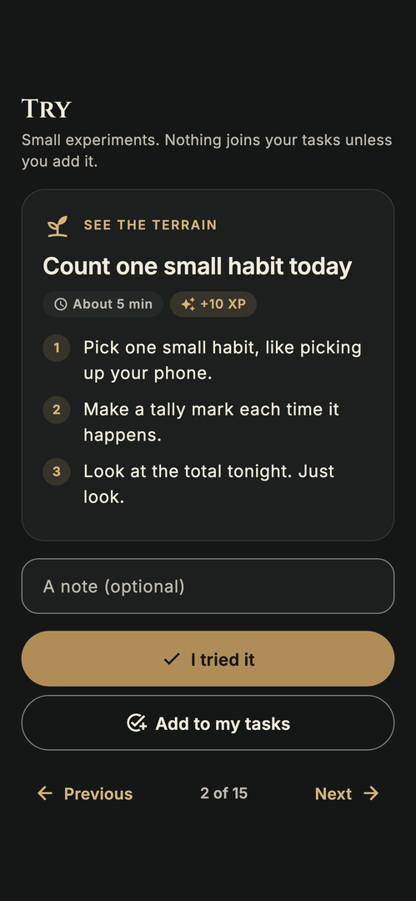<br><sub>Try: one tiny experiment</sub></td>
    <td align="center">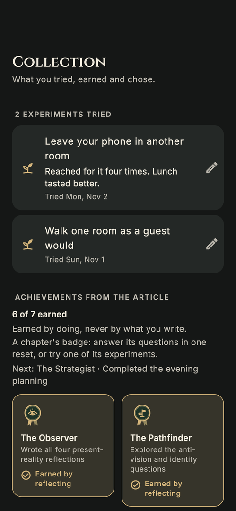<br><sub>Collection: keepsakes & badges</sub></td>
  </tr>
  <tr>
    <td align="center">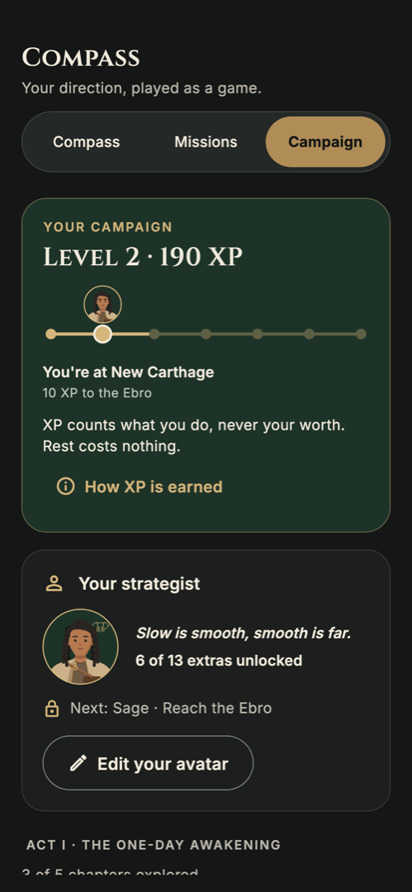<br><sub>Make it yours</sub></td>
    <td align="center">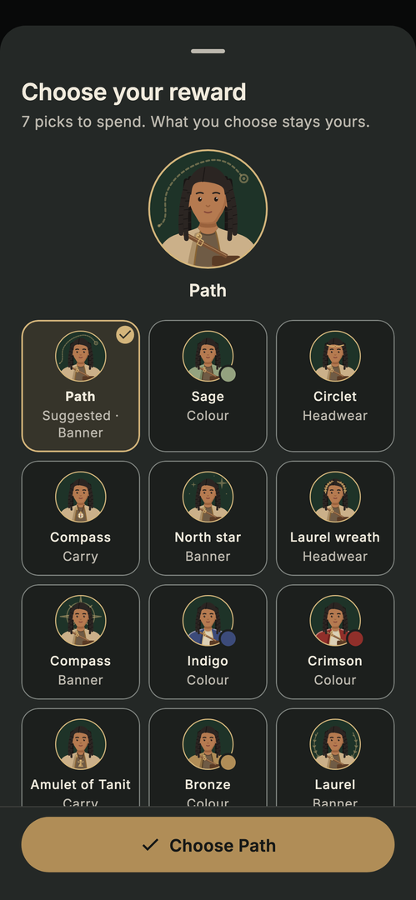<br><sub>Choose your reward</sub></td>
    <td align="center"><br><sub>Battle log</sub></td>
  </tr>
  <tr>
    <td align="center">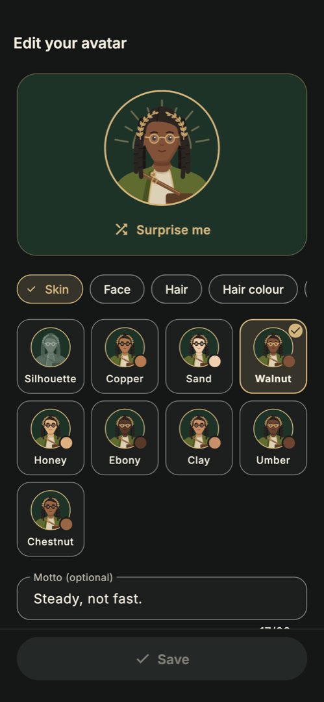<br><sub>Your avatar</sub></td>
    <td align="center"><br><sub>The Campaign · light</sub></td>
    <td align="center">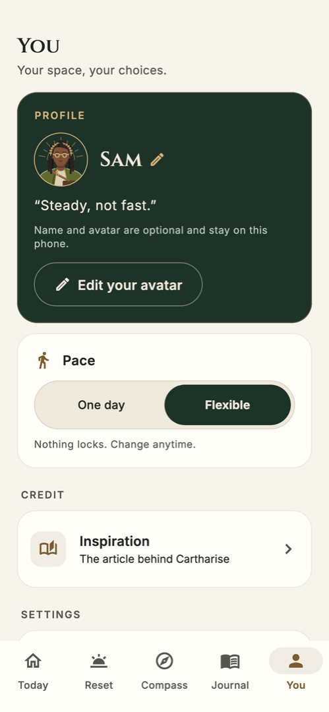<br><sub>You · light</sub></td>
  </tr>
  <tr>
    <td align="center">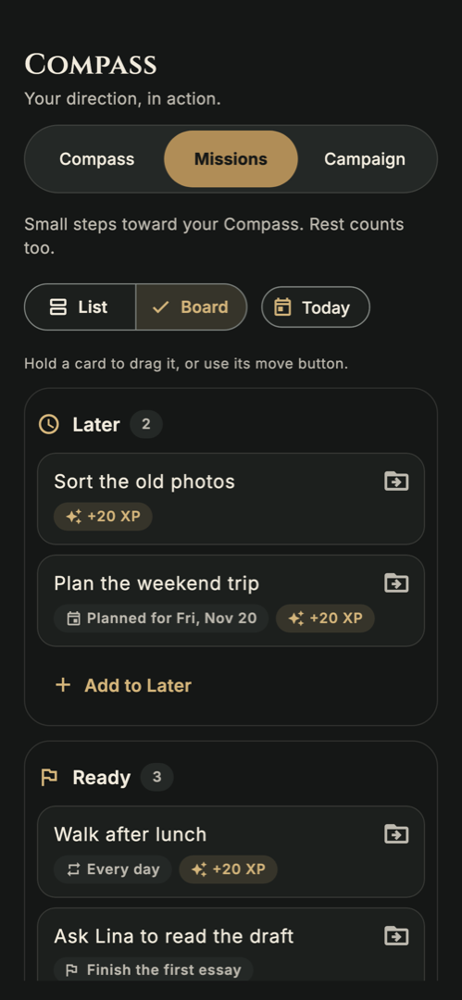<br><sub>The board: Later · Ready · Doing · Done</sub></td>
    <td align="center">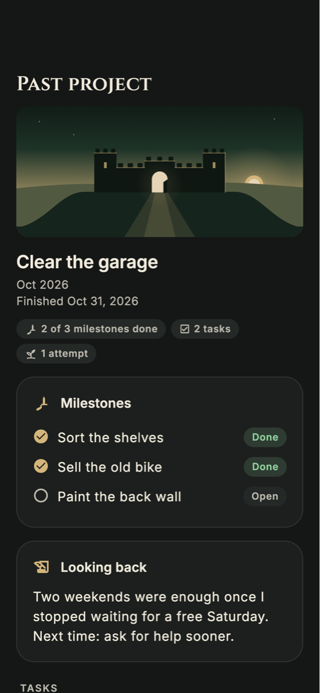<br><sub>Project history</sub></td>
    <td align="center">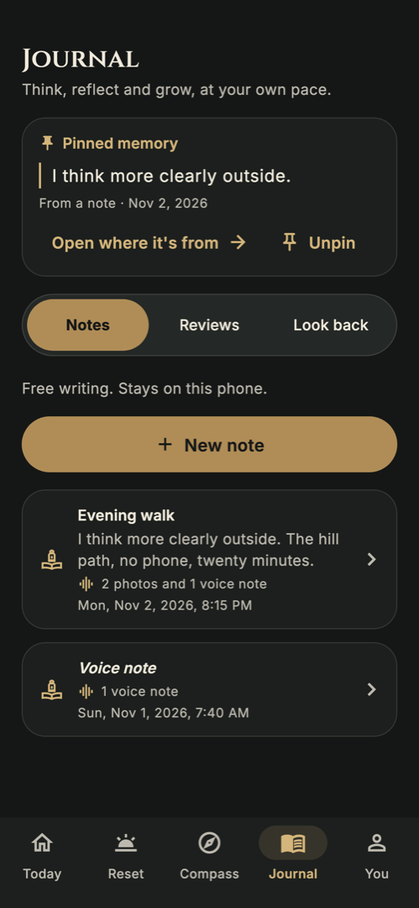<br><sub>Pinned memory, photos & voice notes</sub></td>
  </tr>
  <tr>
    <td align="center">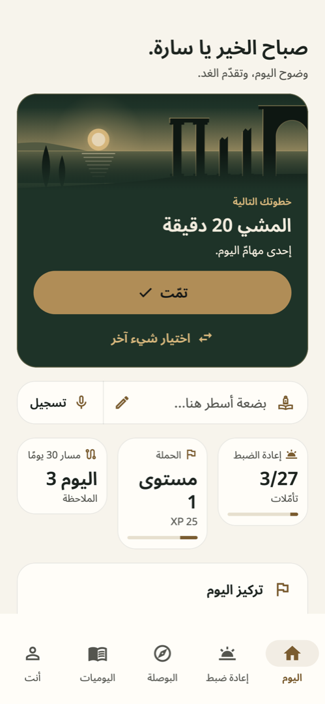<br><sub>Today in Arabic (right to left)</sub></td>
    <td align="center">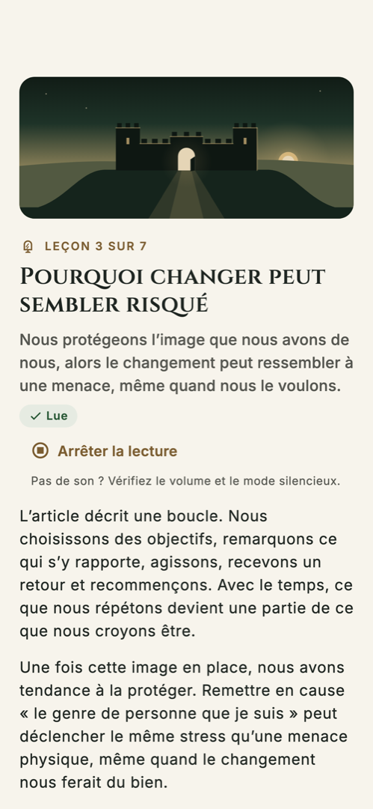<br><sub>A lesson in French · Listen</sub></td>
    <td align="center">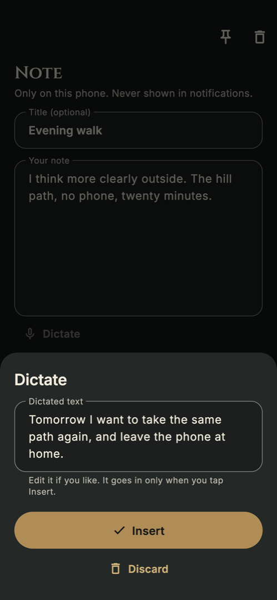<br><sub>Dictate: review, then Insert</sub></td>
  </tr>
  <tr>
    <td colspan="3" align="center">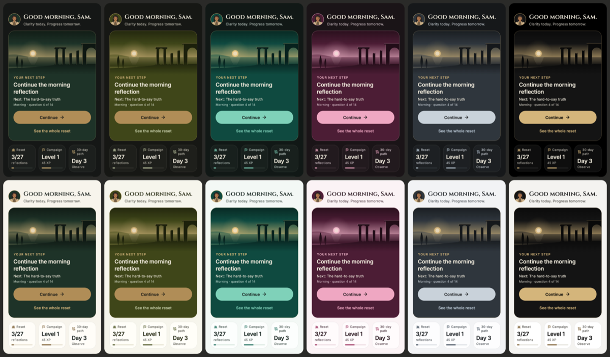<br><sub>Six themes, dark and light: Forest · Olive · Oasis · Tyrian Rose · Alpine · Obsidian</sub></td>
  </tr>
</table>

<sub>Rendered from the real widgets with <code>make screenshots</code>, then cropped to one phone screen. See <a href="#testing">Testing</a>.</sub>

---

## Features

Five tabs: **Today · Reset · Compass · Journal · You**.

**Welcome: five short pages**
- 🐘 Brand and promise · the source credit, what this is and isn't (not therapy) and 18+ · your pace · your name (optional) · privacy and **Start**
- Features are introduced the first time you meet them (one-line hints on Today), not in a carousel

**Today: one useful thing, then an easy stop**
- 🧭 **One next action**, worked out from what you've actually done: an open quest, start or resume the reset, build your Compass, turn levers into quests, a weekly review or a note, on a smaller dawn scene
- 🔀 **Choose something else** lists the other steps that make sense now, plus **Help me with**: my project · reflection · notes · decide for me. Your choice is remembered
- ✅ Once that kind of action is done today: **"Done. That can be enough for today."** with a quiet "One more". After a long absence there are no missed-day counts, just the next action
- ✍️ **Write · Record**: a quick capture. Write opens a new journal note; Record keeps a voice note in a new one (the microphone is asked for only when you tap it)
- 📊 At a glance: three small tiles for your reset (3/27), your Campaign level and your 30-day path day, then today's quests; your direction stays collapsed until you open it
- 🧑 Your avatar beside the greeting, once you've made one

**Reset: the one‑day reset, one question at a time**
- 🌅 **Morning:** 14 questions (*The Mirror*: current reality, possible futures, identity; *The Vision*: a good ordinary day and who you want to become)
- ⏰ **Daytime:** 6 timed check‑ins (*The Interrupt*) at the source times 11:00 · 13:30 · 15:15 · 17:00 · 19:30 · 21:00, plus 3 optional contemplations
- 🌙 **Evening:** 7 questions (*The Breakthrough*) that become your Compass
- ✍️ Saved on the device as you type. Every question has "What does this mean?" and an example that is *not* a right answer, and most offer softer wording. You can go back, skip, jump or pause at any time
- 📜 Past resets stay readable, exactly as you wrote them

**Awakening: the ideas behind it**
- 📖 Seven short lessons in plain words, each with an example, *a lens, not a verdict*, a knowledge check that is never scored or saved, and "Try it" links into the matching questions
- 🖼️ Each lesson has its own painted scene (roots under a tree, an iceberg, a walled town with an open gate, widening arches, a boat tacking to a lighthouse, a day's arc, a route to a summit), on its card and its page
- Optional, in any order. You can start the reset without reading anything

**Compass: your direction, in your own words**
- 🧭 Six fields: **anti‑vision, vision, one‑year mission, one‑month project, daily levers, boundaries**
- 📥 **Use my evening reflections:** a preview with a checkbox per field that only fills *empty* fields, and only once you confirm. Boundaries are only ever written by you
- 🕰️ Versions: save one, compare it with now, restore it. A version is kept automatically before every import or restore

**Missions: small steps**
- ⚡ Daily levers become up to three **editable** daily quests, never added without your OK
- ✅ One‑off and daily quests with Undo. A month project with milestones
- 🗂️ **List or Board:** the same quests as lanes **Later → Ready → Doing → Done** (stacked on phones, four columns on tablets). Move a card with **Move to…** or by dragging, with Undo. A gentle note when Doing gets crowded, Done folded away, and a **Today** filter. Moving earns nothing; finishing a quest earns what ticking it does. Daily quests come back to Ready the next day
- 🏛️ **Project history:** **Finish this project** with a short look back, kept exactly as you write it. Past projects stay readable month by month, with their milestones, the tasks and attempts linked to them, and their photos and voice notes
- 🖼️ **A picture for each project:** one of nine painted scenes, or your own photo, shown small on its tasks and attempts
- 🗺️ An optional **30‑day path** in four stages (Observe · Experiment · Build · Adjust). Every day is open, go at your own pace

**Campaign: the article as a game (optional)**
- 🎲 **Asked once:** new users start with the game off and see "Play the Campaign? XP and levels for what you do." with **Play** / **Not now**. You › The Campaign switches it any time
- 🌱 **The Playground**, a compact hub under your status (avatar at its stop, level, XP to the next): **Notice** (illustrated cards that reopen a question or lesson), **Try** (15 tiny real-world experiments, one at a time, with **I tried it** and an optional note) and **Make it yours**. A try only becomes a task if you tap **Add to my tasks**. With the game off it stays open as Compass › **Playground** (no XP or levels), and a half-typed note is kept as a draft
- 🧳 **Collection (keepsakes):** the experiments you tried with your notes exactly as typed, the seven achievement badges (each its own symbol; earned ones say whether by reflecting, trying — naming the experiment — or doing) and the extras you chose
- 🎁 **Reward picks:** each route stop after Carthage and each achievement gives one pick. **Choose your reward** shows your own avatar wearing each extra, the suggested one first; nothing is spent until you confirm
- ♜ Section VII of the article made playable: your vision is the **win condition**, the anti-vision is **what's at stake**, the one-year mission is the **main campaign**, the one-month project is your **boss fight**, daily levers are **quests** and your boundaries are the **rules of engagement**
- 📜 **Act I:** five chapters built from the reset's exercises (4 · 7 · 3 · 6 · 7 questions), each opening its first open question
- 🗺️ **Hannibal's route:** each level is the next stop from Carthage to Italy, with the XP to the next one. Each stop is its own painted landscape (the round harbour at dawn, New Carthage, the Ebro, the Pyrenees, the Rhône crossing, the Alps by moonlight, Italy), on the hub and the Route page, and each chapter leaves a **keepsake** on the Collection's shelf
- 🛡️ **Monthly boss fight:** the boss weakens as your project's milestones are reached; record what you tried and learned in a battle log you can correct or delete. The form keeps a draft as you type, and a failed save never says "recorded"
- ✨ **Calm moments:** a short "+20 XP", "+10 XP" for a first try, "Achievement earned" or "A new pick for your avatar" when you complete a quest, an attempt or a try, never while you type and never for a restored backup
- 🏷️ **XP previews:** open quests show a small "+20 XP" tag until today's quest XP is reached
- 🏺 **13 avatar extras:** banners, garment colours, a circlet or laurel, a scroll, compass or amulet, chosen with reward picks. Purely cosmetic and kept for good once chosen, even if progress goes down; basic avatar identity is always free, and every extra is open with the game off
- 🧑 **Your strategist:** your avatar stands at your stop on the route; Make it yours shows your motto, how many extras you have and the picks left
- 🏅 **XP, levels and seven achievements**, earned only by doing: answering a question, completing a quest, trying an experiment, writing a 30-day note, recording an attempt, a weekly review. A chapter's achievement comes from answering its questions *or* trying one of its experiments. XP never looks at what you write, rest never costs anything, and one switch in You turns the whole layer off

**Journal: write and look back**
- 📝 Free notes, **weekly reviews** (wins, friction, next experiment)
- 📷 **Photos and voice notes** on notes, tries and attempts: pick a photo or take one, or tap **Record** (a clear "Recording" state, Stop and save; a call or leaving the app keeps what was recorded). Play them back, and add your own words to a voice note if you like; nothing is transcribed for you
- 📌 **Pinned memory:** pin a passage you wrote (the exact words you select) or a photo to the top of the Journal
- 🔍 **Look back:** compare two Compass moments side by side and reread earlier resets

**You: your space, your choices**
- 🧑 **Your avatar ("Your strategist"):** a live preview with 13 categories: skin tone, face, 12 hair styles (from straight to coily, afro, locs and braids) in 8 colours, facial hair, glasses, freckles, a beauty mark or vitiligo, expression, headwear (headscarf, turban, hood…), clothes and a banner, plus "Surprise me" and an optional motto. No gender choice and no default skin: it starts as a silhouette. It shows on You, beside Today's greeting and on Hannibal's route
- 🙏 **Inspiration:** the article, its author and both links, and what is from the source vs added by Cartharise
- 🔔 **Reminders:** opt‑in, six editable check‑in times, quiet hours, or **Add to calendar (.ics)** if you'd rather not get notifications
- 🎨 **Appearance:** six themes, each named for a piece of the story: **Forest**, **Olive**, **Oasis** (palm green and date gold), **Tyrian Rose** (the rose dye of Tyre, Carthage's mother city), **Alpine** (granite and snow of Hannibal's crossing) and **Obsidian** (black and gold, true black when dark) · system / light / dark · motion on/off
- 💾 **Your data:** export a **.zip backup** with your words, settings, photos and voice notes (it says what it includes and how big it is), restore a .zip or an older .json, or delete everything
- 💚 **Support & safety:** what to do when a question feels heavy, and where to find help

**Languages and voice**
- 🌍 **English, French and Arabic** for every screen and all content (lessons, questions with their softer wording and examples, the 30-day path, experiments, reminders, help). French and Arabic are **drafts that still need a native speaker's review**. Pick one in You › Appearance › **Language** (or **Same as phone**); the app switches at once and your own words are never translated or changed
- ↔️ **Arabic reads right to left**, in a bundled Arabic font (Noto Sans Arabic UI, OFL) with Western digits; arrows and Hannibal's route mirror, and your own words keep their own direction, as you type them and wherever they are shown
- 🎙️ **Dictate** under the reset answer, notes, tries, attempts (new and saved), path days and the weekly review: speak, check the text, and it goes in at the cursor only when you tap **Insert**. Recognition runs **on the phone only**; where it can't, the app says so in one line and offers **Record** or typing
- 🔊 **Listen** reads a lesson or a question aloud with the phone's own voices. **Listen to my answer** and **Listen to my note** read your words only when you tap them. **Stop reading** anytime; it stops when you leave and respects silent mode

**Made for real life**
- Works fully **offline**, on 320 dp phones up to tablets, at up to 200 % text size, left to right and right to left
- Dark & light, reduced motion honoured, screen‑reader labels, 48 dp tap targets, keyboard navigation

---

## How it works

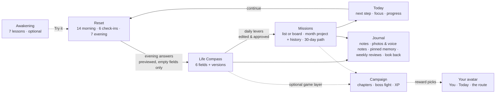

The app is a single Flutter codebase. One `AppState` (a `ChangeNotifier`) holds an immutable
`AppData` snapshot. Every change goes through `mutate`: the screen updates at once, then the
snapshot is written **atomically** to one JSON file (temp file + rename) through a serialised queue.
If a write fails, your words stay on screen and the app says so, offering **Retry** or
**Export a copy**. A damaged file is never overwritten.

The guided content (lessons, 30 questions, the 30‑day path, the credit) is plain Dart in
[`lib/content/`](lib/content), separate from UI strings, so the app can be translated. The
domain layer is pure Dart and unit‑tested. Details: [`docs/architecture.md`](docs/architecture.md).

---

## Gentle by design

> **Your words are yours. Your pace is yours.**

- **Every question can be skipped.** Most can be asked more gently, and *Feeling heavy?* always offers soften, skip, pause or support (with a link to a helpline directory)
- **No streaks, countdowns or guilt.** Progress is counted in words, and nothing locks by time. The optional Campaign is off until you say Play; its XP counts participation only: it never drops, never judges what you write, and turns off in one tap
- **Your words are saved exactly as typed.** Nothing is rewritten, summarised or inferred
- **No labels or diagnoses.** Lessons are lenses, not verdicts. Cartharise is not therapy, and says so
- **Honest when something fails.** Failed saves, denied notification, camera or microphone permission, interrupted recordings and bad backups are shown plainly, with a practical alternative
- For adults (18+), confirmed during onboarding

---

## Tech stack

| | Layer | What's used |
|---|---|---|
|  | App & UI | **Flutter 3.47**, Material 3, `provider`, "Carthage Dusk" role‑token palette (`CarthaPalette`), six themes, each light and dark |
|  | Core logic | **Dart 3.13**: pure‑Dart domain, hand‑written JSON, `intl` + gen‑l10n from per‑area ARB fragments |
| 🎨 | Brand & motion | `EmblemGeometry` (one source for the emblem, its SVGs and icons), the "charging" loader as a `CustomPainter`, `flutter_svg` lockups, vector brand scenes |
| 🔔 | Reminders | `flutter_local_notifications` (inexact daily), `timezone` + `flutter_timezone`; pure `.ics` export |
| 💾 | Files | `path_provider` (atomic JSON store, private `attachments/`), `share_plus` (export), `file_picker` (restore), `archive` (.zip backups) |
| 📷 | Media | `image_picker` (system photo picker / camera), `record` (voice notes, on tap only), `audioplayers` (playback); all on the phone |
| 🎙️ | Voice | Small platform channels, no package: Android `SpeechRecognizer.createOnDeviceSpeechRecognizer` + `TextToSpeech` (offline voices), iOS `SFSpeechRecognizer` (`requiresOnDeviceRecognition`) + `AVSpeechSynthesizer` |
| 🌍 | Languages | English, French, Arabic: per-language ARB fragments and content translations with English fallback per item; right to left from the locale |
| 🔗 | Links | `url_launcher`, used only for the credited article links and the helpline directory |
|  | Typography | **Cinzel** for headlines, **Inter** for everything else, **Noto Sans Arabic UI** for Arabic (all bundled, OFL) |
|  | iOS native | **Swift**: excludes the data folder from iCloud/computer backups; on-device dictation and read aloud |
|  | Android native | **Kotlin** host; manifest rules keep data out of cloud backup and device transfer; on-device dictation and read aloud |
|  | Build | Gradle (Kotlin DSL), `flutter_launcher_icons`, `flutter_native_splash` |
|  | Testing | `flutter_test`: size matrix, accessibility guidelines, end‑to‑end journeys, rendered screenshots |

---

## Getting started

### Prerequisites

- Flutter **3.47+** (Dart 3.13)
- Android SDK + JDK 17–21 for Android
- A Mac with **Xcode** for iOS

### Try it on Android

A test build is in [`dist/cartharise-1.0.0-arm64-v8a.apk`](dist/cartharise-1.0.0-arm64-v8a.apk)
(arm64, for almost every phone from the last ~8 years). Copy it to the phone, open it, and allow
"Install unknown apps" when Android asks. It is signed with the debug key, so uninstall it before
installing a store version later. Checksum: [`dist/SHA256SUMS.txt`](dist/SHA256SUMS.txt).

### Run

```bash
make deps                   # flutter pub get
make run                    # on a connected phone or emulator
make                        # list every target
```

### Build

```bash
make android                # debug APK
make android-release        # release APKs, one per CPU type (obfuscated)
make ios                    # iOS compile check (needs Xcode)
```

### Strings, icons & splash

```bash
make l10n                   # merge l10n_src/*_en.arb → lib/l10n, then generate AppLocalizations
make brand                  # re-export emblem SVGs, lockups, icon + splash PNGs from EmblemGeometry
make icons                  # launcher icons from assets/brand/app_icon_1024.png
make splash                 # native splash screens (forest + emblem)
```

The emblem is drawn in code (`EmblemGeometry` in `lib/ui/widgets/emblem.dart`); every brand
asset is exported from it, and `make check` fails if one drifts.

Add UI strings to your area's fragment in `l10n_src/<area>_en.arb`, not to `lib/l10n/` (that folder
is generated).

---

## Project structure

```text
lib/
├── domain/          content model, AppData (+ JSON), Campaign + persona rules, local dates, backup format (pure Dart)
├── content/         ContentLibrary per language (en source, fr and ar drafts): lessons, questions, 30-day path, experiments, notices, credit
├── data/            DataStore: atomic JSON file · in-memory store for tests · backup exclusion
├── state/           AppState, the single ChangeNotifier
├── reminders/       reminder planning (pure) + notification scheduler
├── services/        .ics export (pure) · share sheet / file picker · attachments store · photo picker · recorder · player · dictation · read aloud
├── l10n/            generated AppLocalizations (from l10n_src/)
└── ui/
    ├── theme/       Carthage Dusk palette, six themes, avatar colours, Cinzel/Inter type
    ├── widgets/     shared kit: buttons, cards, headers, loader, scenes, glyphs, lesson art, badges, pill tabs, save indicator…
    ├── boot_screen.dart · root_shell.dart · nav.dart
    └── onboarding/ today/ reset/ awakening/ compass/ missions/ campaign/ persona/ journal/ media/ voice/ you/
l10n_src/            per-area string fragments → make l10n
assets/
├── brand/           emblem, wordmarks, loader reference, app icons, splash (from the brand guide)
└── fonts/           Cinzel, Inter and Noto Sans Arabic UI with OFL licences
test/                unit, widget, journeys, a11y and screenshot tests
docs/                architecture, one page per feature area, content traceability
tool/merge_arb.dart  merges the ARB fragments
```

| Doc | What's in it |
|---|---|
| [`PLAN.md`](PLAN.md) | Build plan and contract between areas: IA, design tokens, AppState API, content spec |
| [`docs/architecture.md`](docs/architecture.md) | Layers, data flow, persistence, reminders, loading sequence |
| [`docs/features/`](docs/features) | One page per area: onboarding, today, reset, awakening, compass, missions, campaign, persona, journal, you |
| [`docs/content-traceability.md`](docs/content-traceability.md) | Source segment → question → where it lives in the app |
| [`docs/features/campaign.md`](docs/features/campaign.md) | The Campaign (game version): the invitation, the Playground hub, mapping, chapters, XP rules, battle log, Collection, reward picks |
| [`docs/translations.md`](docs/translations.md) | Languages: how strings and content are translated, French and Arabic writing rules, right to left, review status |
| [`docs/features/voice.md`](docs/features/voice.md) | Dictate and Listen: where they are, the on-device rules, platforms, tests |
| [`docs/plans/evolve.md`](docs/plans/evolve.md) | The evolve plan: lighter Today, the Playground, the board, voice and languages (three steps) |
| [`docs/features/persona.md`](docs/features/persona.md) · [`docs/plans/persona.md`](docs/plans/persona.md) | Your avatar: portrait, builder, reward picks, and the plan with its audit fixes |
| [`CLAUDE.md`](CLAUDE.md) | Project rules: privacy, emotional safety, UI base, strings |
| [`Cartharise_Requirements.html`](Cartharise_Requirements.html) | Product requirements (F‑001…F‑057) |
| [`Cartharise_Game_Requirements.html`](Cartharise_Game_Requirements.html) · [`Cartharise_Game.html`](Cartharise_Game.html) | Game version requirements (F‑058…F‑064) and its browser prototype |
| [`CARTHARISE_Brand_Guide.html`](CARTHARISE_Brand_Guide.html) | Brand guide: colours, type, emblem, loader |

---

## Privacy

> **Your words stay yours.**

- No account, no Cartharise server, no analytics, ads or crash‑reporting SDKs. The release build doesn't even ask for internet access
- Everything lives in **one file in the app's private folder**. It isn't encrypted by Cartharise and isn't synced, and it's **kept out of phone and cloud backups** (Android backup rules, iOS backup exclusion)
- **Photos and voice notes stay on the phone**, copied into the app's private `attachments/` folder and kept out of phone and cloud backups like the data file. The **microphone** is asked for only when you tap Record, and the camera or photos only when you add a photo; a refusal is said plainly, with another way (typing, or choosing a photo instead)
- **Speech stays on the phone.** **Dictate** works only with an on-device recognizer (Android 12+ with `createOnDeviceSpeechRecognizer`, iOS with on-device recognition for the language): never a cloud recognizer, never a silent fallback to one. Otherwise the app says why and offers **Record** (a voice note, never transcribed) or typing. The dictated text is shown for review and goes in only when you tap Insert
- **Listen** uses the phone's own offline voices; your own words are read aloud only when you tap **Listen to my answer** or **Listen to my note**. Dictate asks for the microphone (and, on iOS, speech recognition) only when you first tap it; Listen needs no permission
- Notifications show only the check‑in's title, **never your words**. Nothing you write or say goes into logs
- **You › Your data:** export a `.zip` backup (`data.json` plus your photos and voice notes) through the share sheet, restore a `.zip` or an older `.json` (fully validated and previewed before anything changes), or **delete all data**. Deleting removes the file, the photos and recordings, the temporary export/import copies, and cancels every reminder

---

## Testing

```bash
make check                  # flutter analyze + flutter test (must be clean and green)
make screenshots            # render every screen, dark & light → test/screenshots/out/
```

The suite covers the domain model and JSON round‑trips, the state API, atomic saves and save
failures, reminder planning (quiet hours across midnight, DST), the `.ics` format, the content library
(ids, mapping to the Compass, no banned words) and the l10n merge. It also includes:

- One widget test file per area, each run across a **size matrix**: 320×568 at 200 % text, 390×844, and 1024×1366 at 130 %, in dark and light
- **Accessibility** checks (tap size, labels, text contrast) on 23 screens, plus a keyboard‑only pass
- **End‑to‑end journeys** through the real app and content: onboarding → full reset → previewed Compass import → quests → journal → `.ics` → export, delete everything, restore; create an avatar → You, the Campaign and Today show it → backup, delete, restore; the five-page welcome → the Campaign invitation (Play / Not now); a remembered Today pin → "Done. That can be enough for today."; Try → Add to my tasks → Collection → Choose your reward; an honest failed attempt save with its draft kept; quests → the board → Move to… → Done, a daily quest back in Ready the next day; a project finished with its look back → the history with its tasks, attempts and their photos; a photo and a voice note on a note → a pinned passage → `.zip` backup → delete everything (files too) → restore; an older `.json` backup still restoring; a French phone's welcome; switching to Français → a lesson read aloud → a dictated answer reviewed and inserted exactly → العربية right to left at 320 dp and 200 % → Same as phone, with your words unchanged; dictation unavailable → Record or type
- **Languages:** 100 % French and Arabic strings and content, placeholders and plurals, French typography, no streak or guilt wording in any language, the Arabic font everywhere, right to left on every main screen at every size
- Guard tests: no hard‑coded colours outside the theme, no streak or guilt copy, privacy settings pinned in the manifest, on-device-only speech and no logging in the native voice code

Notifications, the share sheet, the file picker, the photo picker, the recorder, the player,
dictation and read aloud are tested with fakes (and mocked platform channels). The real ones
still need a check on a device.

---

## Status & roadmap

| | |
|---|---|
| ✅ | Android app: all five tabs, reminders, `.ics`, the board, project history, photos and voice notes, `.zip` backup and restore; analyze clean, tests green |
| ✅ | Evolve plan step 3: French and Arabic (right to left), on-device Dictate, Listen, painted route scenery and keepsakes |
| 🧪 | iOS: configured (notifications, icons, splash, backup exclusion, dictation and read aloud) but not yet compiled; needs a Mac with Xcode |
| 🧪 | On‑device checks: notification permission, share sheet, file picker, photo picker and camera, microphone and playback, on-device dictation and read aloud, Android 12+ splash, backup exclusion |
| 🔜 | Native review of the French and Arabic drafts (required before releasing in either language) |
| 🔜 | Content & legal review of the paraphrased lessons and questions; trademark check on the name |
| 🔜 | Store release: privacy policy, store privacy forms, signing, release builds |
| 🔜 | Remember set‑aside lever drafts across restarts; per‑field "last updated" on the Compass |

---

## Credits & licences

- **Source**: *[How to fix your entire life in 1 day](https://x.com/thedankoe/status/2010751592346030461)*
  by **Dan Koe** (23 December 2025), also in [his newsletter](https://letters.thedankoe.com/p/how-to-fix-your-entire-life-in-1).
  Cartharise is an independent app and is not affiliated with, sponsored by or endorsed by Dan Koe. The
  lessons and questions are paraphrased in Cartharise's own words, and the article is not reproduced.
  The 30‑day path, quests, journal and weekly reviews are Cartharise additions.
  See [`docs/content-traceability.md`](docs/content-traceability.md).
- **Brand**: Cartharise emblem, wordmarks, animated loader and app icons from the
  [brand guide](CARTHARISE_Brand_Guide.html) ([`assets/brand/`](assets/brand))
- **Cinzel** by Natanael Gama: [SIL Open Font License 1.1](assets/fonts/Cinzel-OFL.txt) (bundled)
- **Inter** by Rasmus Andersson: [SIL Open Font License 1.1](assets/fonts/Inter-OFL.txt) (bundled)
- **Stack logos**: [Simple Icons](https://simpleicons.org) (CC0) and [Shields.io](https://shields.io) badges
- Open‑source packages are listed in [`pubspec.yaml`](pubspec.yaml), each under its own licence

No licence has been chosen for Cartharise's own code yet, so all rights are reserved until one is added.

<div align="center">
<br>

<br>
<sub>Clarity today. Progress tomorrow.</sub>
</div>
